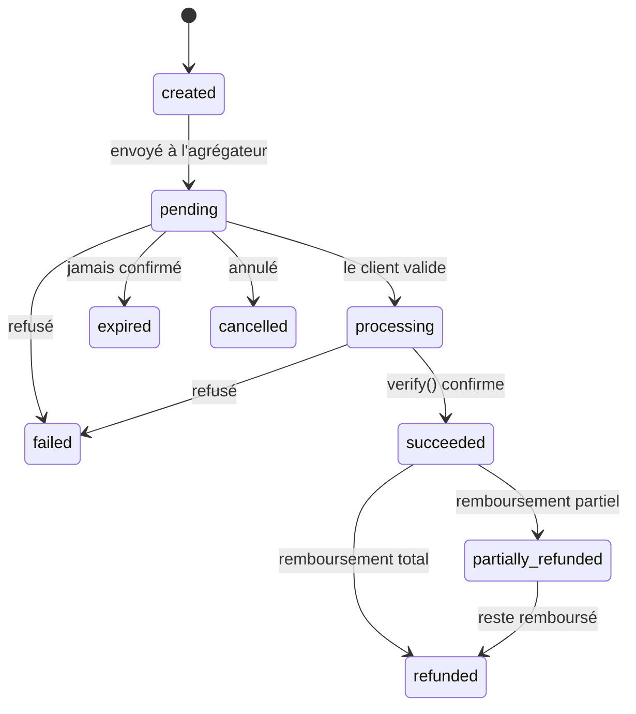
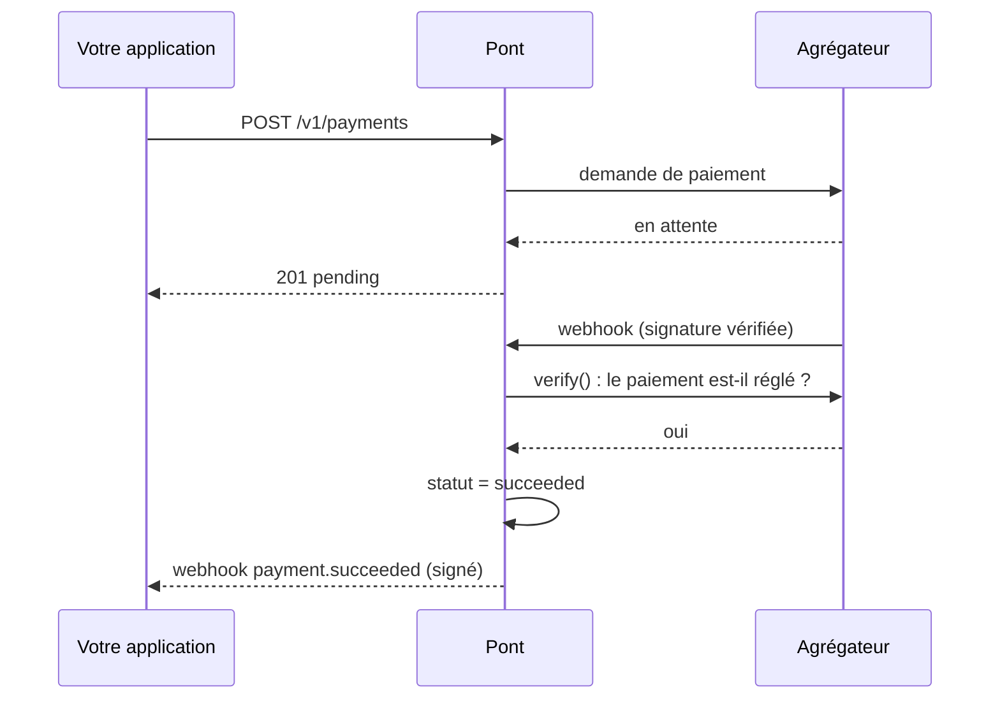

Chaque agrégateur a ses propres statuts. Pont les ramène à un **modèle unique**.

| Statut | Sens |
|---|---|
| `pending` | Créé, en attente du client |
| `processing` | Le client a validé, l'agrégateur traite |
| `succeeded` | Confirmé **et vérifié** auprès de l'agrégateur |
| `failed` | Refusé ou échoué |
| `expired` | Jamais confirmé dans le délai |
| `cancelled` | Annulé |
| `refunded`, `partially_refunded` | Remboursé en totalité ou en partie |

## Le cycle de vie

Un paiement ne passe à `succeeded` qu'après `adapter.verify()` : Pont interroge l'agrégateur, il ne croit jamais un webhook sur parole.

## Le cas ambigu : `needsReconciliation`

« Ambigu » n'est **pas** un statut. Quand l'agrégateur ne permet pas de savoir si l'argent est parti (délai dépassé, réponse incohérente), le paiement garde son statut et porte `needsReconciliation: true`. Pont ne devine pas : il **vérifie** à chaque cycle tant que l'agrégateur ne tranche pas, et émet l'événement `payment.needs_reconciliation`. Pont ne réessaie jamais le paiement chez un autre agrégateur, ce qui éviterait un double débit.

## Réconciliation

Toutes les 30 secondes (`PONT_TICK_SECONDS`), Pont revérifie les opérations non réglées. Un webhook perdu ne bloque donc jamais un paiement.

## Les scénarios du sandbox

Les 7 derniers chiffres du numéro choisissent le comportement : voir [Premier paiement](/demarrer/premier-paiement).
