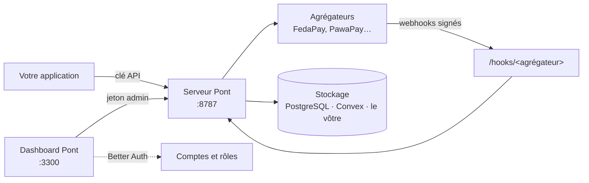

Pont est un orchestrateur de paiement **BYOK** pour l'Afrique francophone : vos clés d'agrégateurs (FedaPay, PawaPay, PayDunya, Kkiapay) restent sur votre serveur, Pont unifie l'API, les webhooks, le sandbox et la sécurité. Le self-host est **gratuit à vie**.


## Ce que vous installez



| Service | Port | Rôle |
|---|---|---|
| `pont` | 8787 | API `/v1`, API du dashboard `/admin`, réception des webhooks `/hooks`, planificateur |
| `dashboard` | 3300 | Interface web : aperçu, paiements, portefeuilles, registre, utilisateurs, rôles ; sert aussi l'authentification (`/api/auth`) |
| `backend` + `convex-dashboard` | 3210, 6791 | Convex self-hosted (si `PONT_STORE=convex`) |
| `postgres` | interne | PostgreSQL fourni (si `PONT_STORE=postgres` sans `DATABASE_URL`) |


## Installation

Prérequis : Docker, openssl.

```bash
cd deploy/self-host
./setup.sh                    # stockage PostgreSQL (défaut : paiements, portefeuilles et registre)
./setup.sh --store convex     # stockage Convex (paiements seulement, pas de portefeuille ni de registre)
```

Le script :
1. crée `.env` et y génère tous les secrets (jamais affichés) ;
2. démarre le stockage choisi et y crée les tables Pont ;
3. démarre le serveur et le dashboard.

Relançable sans risque : un secret existant n'est jamais écrasé. Ouvrez ensuite http://localhost:3300 : **le premier visiteur crée le compte administrateur**, ensuite les inscriptions sont fermées.
