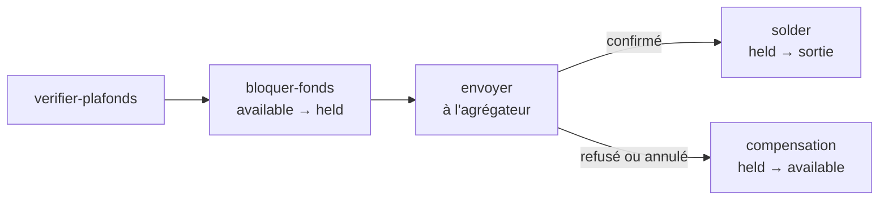

Pour une fintech de type portefeuille mobile, porte-monnaie, tontine ou néobanque légère : comptes utilisateurs avec solde, dépôts par mobile money, retraits, transferts entre utilisateurs, frais, plafonds par palier KYC et gel de compte. Le tout repose sur un **registre comptable en partie double**.

> **Disponible avec `PONT_STORE=postgres`** (la base fournie ou la vôtre). Avec Convex, les routes `/v1/wallets` répondent `501 ledger_unavailable` et le dashboard masque les pages Portefeuilles et Registre. Le mode `memory` (tests) supporte aussi le portefeuille, sans persistance.

<Figure fichier="portefeuilles.webp" alt="Liste des portefeuilles" legende="Les portefeuilles dans le dashboard." />

<Figure fichier="registre.webp" alt="Registre comptable" legende="Le registre en partie double." />

## Comment ça marche

Chaque utilisateur a deux comptes dans la devise du portefeuille (`PONT_WALLET_CURRENCY`, `XOF` par défaut) :

| Compte | Sens | Contenu |
|---|---|---|
| `wallet:<user>:XOF:available` | ce que vous devez à l'utilisateur | Solde disponible |
| `wallet:<user>:XOF:held` | idem | Fonds bloqués pour un retrait en cours |

Et des comptes système, un par agrégateur : `system:transit:<agrégateur>:XOF` (fonds de la fintech chez l'agrégateur) et `system:fees:XOF` (frais perçus).

Chaque opération est une **écriture équilibrée** (total des débits = total des crédits), **immuable** et **idempotente**. Un compte utilisateur ne peut jamais passer en négatif, même avec 50 retraits simultanés (testé sur PostgreSQL : exactement le bon nombre passe, aucun découvert).

### Dépôt

1. Votre application appelle `POST /v1/wallets/<user>/deposits` : les plafonds sont contrôlés, puis un paiement mobile money est créé.
2. Quand l'agrégateur confirme (webhook ou vérification), Pont **crédite le portefeuille**. La clé d'écriture est l'identifiant du paiement : un paiement n'est crédité qu'une seule fois, même si l'événement est rejoué.

### Retrait



1. Plafonds contrôlés, puis les fonds (montant + frais) passent de `available` à `held`.
2. Le transfert est envoyé à l'agrégateur.
3. Confirmé : les fonds bloqués sont soldés. Refusé ou annulé : ils retournent dans `available`. Un retrait refusé immédiatement est annulé et les fonds restitués dans la même requête.

### Transfert entre utilisateurs

`POST /v1/wallets/transfers` : débit de l'un, crédit de l'autre, en une seule écriture, avec contrôle des plafonds des deux côtés.

### Rattrapage

Si le serveur s'arrête entre la confirmation d'un paiement et son crédit, le crédit n'est pas perdu : toutes les 30 secondes, Pont rejoue les opérations confirmées des dernières 24 h. Les écritures étant idempotentes, un doublon ne crédite jamais deux fois.

## Plafonds et paliers KYC

Chaque utilisateur a un **palier** (`PUT /v1/wallets/<user>` avec `tier`), et chaque palier fixe quatre plafonds :

| Plafond | Sens |
|---|---|
| `maxBalance` | Solde total maximal (disponible + bloqué) |
| `maxSingle` | Montant maximal par opération |
| `maxDailyOut` | Sorties maximales sur 24 h |
| `maxMonthlyOut` | Sorties maximales sur 30 jours |

Par défaut : `basique` (solde 200 000, par opération 50 000, 100 000 par jour, 500 000 par mois) et `complet` (2 000 000, 500 000, 1 000 000, 5 000 000). **Ce sont des exemples, pas des valeurs réglementaires** : les plafonds exacts dépendent de votre agrément (paliers BCEAO applicables). Définissez les vôtres avec `PONT_LIMITS` :

```bash
PONT_LIMITS='{"tiers":{"decouverte":{"maxBalance":100000,"maxSingle":25000,"maxDailyOut":50000,"maxMonthlyOut":200000}}}'
```

Un utilisateur sans palier ne peut rien faire (`unknown_tier`). Le palier par défaut d'un rôle (`kycTier`, voir [rôles](/guides/roles-et-authentification)) est exposé par `/api/pont/can` : votre application peut l'appliquer à l'ouverture du portefeuille.

**Gel de compte.** Un compte gelé ne peut plus rien sortir (retrait, transfert sortant) ; il peut encore recevoir. Dashboard : page du portefeuille, bouton « Geler le compte » (permission `portefeuille.debiter`), ou `POST /admin/wallets/<user>/freeze`.

## Configuration

| Variable | Rôle |
|---|---|
| `PONT_WALLET_CURRENCY` | `XOF` (défaut) ou `XAF` |
| `PONT_LIMITS` | Plafonds par palier (JSON, ci-dessus) |
| `PONT_WITHDRAWAL_FEE_BPS` | Frais de retrait en points de base : `100` = 1 %, `0` par défaut |

Les frais s'ajoutent au montant envoyé : retirer 5 000 avec 2 % de frais débite 5 100.

## API

Authentification `Authorization: Bearer <PONT_API_KEY>`. Montants entiers. `reference` obligatoire (64 caractères max) : elle sert de clé d'idempotence, ou fournissez `Idempotency-Key`.

| Route | Rôle |
|---|---|
| `PUT /v1/wallets/<user>` | Ouvre le portefeuille. Corps : `{ "tier": "basique", "frozen": false }` (les deux facultatifs) |
| `GET /v1/wallets/<user>` | `{ userId, currency, available, held, tier, frozen }` |
| `GET /v1/wallets/<user>/movements` | Mouvements du solde disponible (100 derniers) |
| `POST /v1/wallets/<user>/deposits` | `{ amount, country, phone, operator?, reference }` → paiement (`201`) |
| `POST /v1/wallets/<user>/withdrawals` | `{ amount, country, phone, operator, reference }` → `{ id, status, payoutId, amount, fee }` (`201`) |
| `POST /v1/wallets/transfers` | `{ from, to, amount, fee?, reference }` → les deux portefeuilles (`201`) |

`<user>` : 1 à 64 caractères parmi lettres, chiffres, `-` et `_` (votre identifiant d'utilisateur).

Erreurs métier (`422`) :

| Code | Sens |
|---|---|
| `limit_exceeded` | Plafond dépassé. `limit` : `max_single`, `max_balance`, `max_daily_out`, `max_monthly_out`, `frozen` ou `unknown_tier` |
| `insufficient_funds` | Solde insuffisant (`available`, `required`) |
| `withdrawal_failed` | Retrait refusé par l'agrégateur ; fonds restitués |

Dashboard (jeton admin) : `GET /admin/wallets`, `GET /admin/wallets/<user>`, `POST /admin/wallets/<user>/freeze` (`{ "frozen": true }`), `GET /admin/ledger` (comptes système et 50 dernières écritures).

## Dashboard

- **Portefeuilles** (`portefeuille.lire`) : liste avec solde disponible, bloqué, palier et état ; détail avec mouvements ; gel et dégel.
- **Registre** (`registre.lire`) : fonds chez chaque agrégateur, frais perçus, dernières écritures avec leurs lignes de débit et de crédit.

## Limites actuelles

- Une seule devise par instance.
- Pas de remboursement d'un dépôt crédité (annulation d'écriture disponible dans `@pont-bj/ledger`, non exposée par l'API).
- Les frais de transfert sont acceptés (`fee`) mais pas calculés automatiquement ; seuls les frais de retrait ont une grille (`PONT_WITHDRAWAL_FEE_BPS`).
- Un utilisateur sans palier est bloqué : votre application doit définir le palier à l'ouverture.
