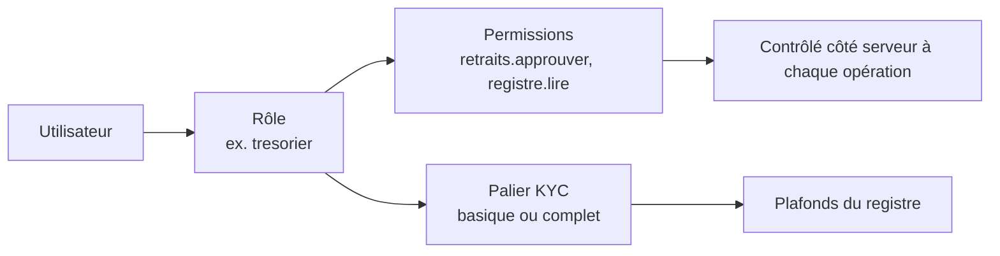

Pont fournit l'authentification des utilisateurs de **votre** fintech (Better Auth) et un système de rôles que vous définissez vous-même : clients, agents, trésorier, vendeurs… Le dashboard Pont sert à la fois d'interface d'administration et de serveur d'authentification.

<Figure fichier="roles.webp" alt="Page Rôles du dashboard" legende="Chaque rôle coche les actions autorisées, ressource par ressource." />

## Principe

- Chaque utilisateur a **un rôle** (un identifiant comme `client` ou `tresorier`).
- Un rôle est un ensemble de **permissions** : une *action* sur une *ressource* (`paiements.creer`, `retraits.approuver`, `registre.lire`…).
- Un rôle peut porter un **palier KYC** (`kycTier`), clé du palier de plafonds du registre (`@pont/ledger`).
- Les rôles sont stockés dans le dashboard et **modifiables à chaud** (page « Rôles »), sans redéployer.
- Un rôle inconnu, vide ou nul n'a **aucune** permission.



### Ressources et actions

| Ressource | Actions |
|---|---|
| `dashboard` | `acceder` |
| `paiements` | `creer`, `lire`, `rembourser` |
| `retraits` | `creer`, `lire`, `approuver` |
| `portefeuille` | `lire`, `crediter`, `debiter` |
| `registre` | `lire` |
| `webhooks` | `lire`, `gerer` |
| `cles` | `lire`, `gerer` |
| `utilisateurs` | `lire`, `gerer` |
| `roles` | `lire`, `gerer` |

`dashboard.acceder` est **distinct** de `paiements.lire` : un client peut lire ses paiements dans votre application sans voir ceux des autres dans le dashboard. Seuls les rôles qui l'ont explicitement entrent dans le dashboard.

## Modèles de départ

`PONT_ROLES_PRESET` choisit les rôles créés au premier lancement :

| Modèle | Rôles |
|---|---|
| `portefeuille` (défaut) | `client`, `agent`, `comptable`, `admin` |
| `tontine` | `membre`, `tresorier`, `president`, `admin` |
| `marketplace` | `acheteur`, `vendeur`, `support`, `admin` |

Ensuite, tout se modifie dans le dashboard : créer un rôle, cocher ses permissions, le supprimer (impossible tant qu'un utilisateur l'a).

## Règles de sécurité

- Le rôle **`admin`** existe toujours et garde l'accès total : il ne peut ni être supprimé, ni perdre ses droits.
- Il reste toujours **au moins un administrateur** ; personne ne peut retirer l'accès total à son propre compte.
- Le premier compte créé sur `/setup` devient `admin`.
- **Inscription publique fermée** par défaut. Pour l'ouvrir, `PONT_SIGNUP_ROLE=client` : les inscrits reçoivent ce rôle (jamais `admin`). Sinon, un administrateur crée les comptes dans « Utilisateurs ».
- Instance créée avant les rôles : au démarrage, le plus ancien compte devient `admin`.
- Les permissions sont vérifiées **côté serveur** à chaque page et chaque action ; masquer un lien n'est pas une protection.

## Définir ses rôles dans le code

Pour versionner vos rôles ou les générer, le paquet `@pont/auth` valide une configuration :

```ts
// pont.config.ts
import { definePont } from "@pont/auth";

export default definePont({
  roles: {
    client:    { label: "Client",    permissions: { paiements: ["creer", "lire"], portefeuille: ["lire"] }, kycTier: "basique" },
    tresorier: { label: "Trésorier", permissions: { retraits: ["creer", "lire", "approuver"], registre: ["lire"], dashboard: ["acceder"] } },
    admin:     { label: "Administrateur", all: true },
  },
});
```

`definePont` lève une erreur lisible pour une ressource ou une action inconnue, un identifiant invalide ou un rôle « accès total » mélangé à des permissions. La classe `RoleSet` fournit `can(role, ressource, action)` et `permissionsOf(role)`.

## Vérifier une permission depuis votre application

Votre application garde ses propres routes ; elle demande à Pont si l'utilisateur a le droit. Le dashboard expose :

```
POST /api/pont/can            (port du dashboard, 3300)
Authorization: Bearer <PONT_API_KEY>
```

```json
{ "cookie": "<en-tête Cookie de la requête de l'utilisateur>", "resource": "paiements", "action": "creer" }
```

Ou `"userId": "…"` à la place de `cookie` si vous connaissez déjà l'identifiant. Réponse :

```json
{ "allowed": true, "role": "client", "kycTier": "basique" }
```

- Le rôle est toujours lu en base, jamais fourni par l'appelant.
- Cookie sans session valide : `{ "allowed": false, "role": null, "reason": "no_session" }`.
- Clé API absente ou fausse : `401`.

Exemple côté backend de votre application :

```ts
async function peut(request: Request, resource: string, action: string): Promise<boolean> {
  const response = await fetch(`${process.env.PONT_DASHBOARD_URL}/api/pont/can`, {
    method: "POST",
    headers: { authorization: `Bearer ${process.env.PONT_API_KEY}`, "content-type": "application/json" },
    body: JSON.stringify({ cookie: request.headers.get("cookie") ?? "", resource, action }),
  });
  return response.ok && ((await response.json()) as { allowed: boolean }).allowed;
}
```

## Connecter les utilisateurs de votre application

L'authentification est servie par le dashboard sous `/api/auth/*` (Better Auth). Renseignez l'URL de votre application dans `PONT_TRUSTED_ORIGINS` pour l'autoriser à l'appeler, puis utilisez le client Better Auth (`createAuthClient({ baseURL: <URL du dashboard> })`) pour la connexion. Les cookies de session ne sont partagés entre votre application et le dashboard que sur un même domaine parent (par exemple `app.exemple.bj` et `pont.exemple.bj`).

## Limites actuelles

- Un utilisateur a un seul rôle.
- Pas de bannissement, de réinitialisation de mot de passe par e-mail ni d'authentification à deux facteurs dans l'interface (Better Auth les prend en charge ; ils ne sont pas branchés).
- Le portefeuille et le registre n'appliquent pas encore `kycTier` : le palier est exposé, mais les plafonds viennent avec l'intégration du registre au serveur.
- Pas d'organisations ni de rôles par organisation.
