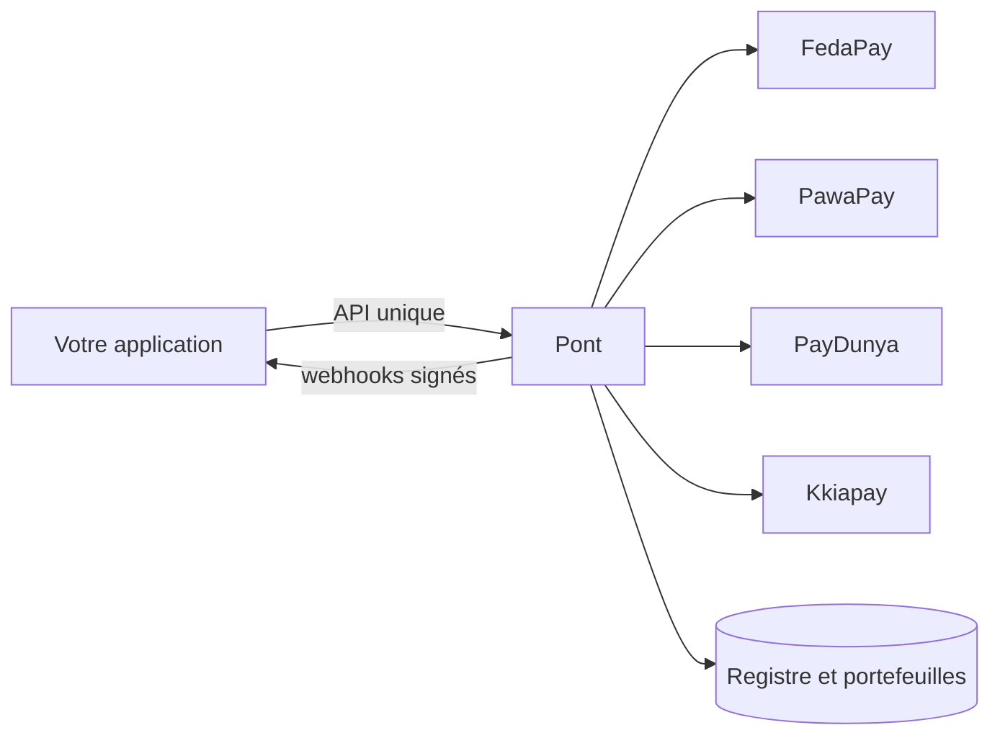

Pont est un **orchestrateur de paiement non-custodial** et un **framework de backend fintech** pour l'Afrique francophone. Vous branchez vos propres comptes FedaPay, PawaPay, PayDunya ou Kkiapay ; Pont unifie l'API, les webhooks, le sandbox, le registre comptable, les rôles et le dashboard.

<Cards>
  <Card title="Démarrer en 5 minutes" href="/demarrer/installation">
    `./setup.sh`, puis un premier paiement dans le sandbox, sans compte d'agrégateur.
  </Card>
  <Card title="Comprendre le fonctionnement" href="/concepts/non-custodial">
    Non-custodial, idempotence, statuts, self-host et Cloud.
  </Card>
  <Card title="Construire une fintech" href="/guides/portefeuille-et-registre">
    Portefeuilles, plafonds KYC, retraits, rôles et authentification.
  </Card>
  <Card title="Travailler avec un agent IA" href="/agents-ia">
    Serveur MCP, détection de la stack, `llms.txt`.
  </Card>
  <Card title="Ligne de commande" href="/reference/cli">
    Les commandes `pont` : init, doctor, trigger, recettes, intégrer un agrégateur absent.
  </Card>
  <Card title="Paquets npm" href="/reference/paquets">
    Les modules `@pont-bj/*` et la commande d'installation de chacun.
  </Card>
</Cards>

## Comment ça s'assemble

## Ce que Pont fait

- **Une API pour tous les agrégateurs** : paiement, retrait, remboursement, statuts normalisés.
- **Sandbox à numéros magiques** : testez succès, échecs, webhooks en double ou tardifs sans compte.
- **Webhooks fiables** : entrants vérifiés, sortants signés avec relances sur 3 jours.
- **Registre en partie double** : portefeuilles, frais, plafonds KYC, gel de compte.
- **Rôles et authentification** : vous définissez les rôles de votre fintech, Better Auth s'y adapte.
- **Dashboard** : paiements, portefeuilles, registre, utilisateurs, rôles, clés et webhooks.

## Ce que Pont ne fait pas

- Pont **ne détient jamais de fonds**. L'argent circule entre vos clients, les agrégateurs et vous.
- Pont n'est pas un agrément d'établissement de paiement : la conformité réglementaire reste la vôtre.

## Gratuit et open source côté self-host

Le self-host est **gratuit à vie**. Pont Cloud, la version hébergée et payante, n'existe pas encore : voir [Pont Cloud](/cloud). Et pour savoir précisément ce qui a été vérifié, voir [Ce qui est testé](/etat-des-tests).

## Le dashboard en un coup d'œil

<Figure fichier="apercu.webp" alt="Vue d'ensemble du dashboard Pont" legende="Le dashboard installé avec Pont. Visite complète : voir la visite guidée du dashboard." />
