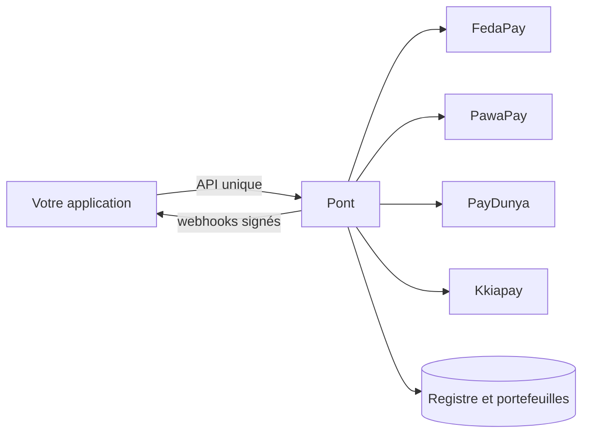

**Encaissez, décaissez et tenez des soldes par mobile money avec une seule API, sans reconstruire un backend de paiement.** Vous branchez vos propres comptes d'agrégateurs ; Pont unifie le reste.

## Que voulez-vous faire ?

<Cards>
  <Card title="Encaisser un paiement" href="/tutoriels/paiement-de-factures">
    Un back-end TypeScript complet : créer, confirmer et rembourser.
  </Card>
  <Card title="Manipuler de l'argent" href="/tutoriels/portefeuille-mobile">
    Comptes, dépôts, retraits, transferts et plafonds KYC.
  </Card>
  <Card title="Prendre seulement une brique" href="/modules">
    Un paquet npm dans votre app, sans serveur à cloner.
  </Card>
</Cards>

## Essayer en deux commandes

```bash
npm install @pont-bj/node
```

```ts
import { createPontFromEnv } from "@pont-bj/node";

// avec PONT_SANDBOX=true : aucun compte d'agrégateur requis
const pont = createPontFromEnv();

const paiement = await pont.createPayment(
  {
    amount: 5000,
    currency: "XOF",
    country: "BJ",
    customer: { phone: "+2290100000001" },
    reference: "commande-42",
  },
  "commande-42-essai-1",
);
```

Pas de code à écrire ? Lancez le serveur complet : [Démarrer en 5 minutes](/demarrer/installation).

## Comment ça s'assemble



## Ce que Pont fait

- **Une API pour tous les agrégateurs** : paiement, retrait, remboursement, statuts normalisés.
- **Sandbox à numéros magiques** : testez succès, échecs, webhooks en double ou tardifs sans compte.
- **Webhooks fiables** : entrants vérifiés, sortants signés avec relances sur 3 jours.
- **Registre en partie double** : portefeuilles, frais, plafonds KYC, gel de compte.
- **Rôles et dashboard** : rôles de votre fintech, paiements, portefeuilles, registre, clés et webhooks.

## Ce que Pont ne fait pas

- Pont **ne détient jamais de fonds** : l'argent circule entre vos clients, les agrégateurs et vous.
- Pont n'est pas un agrément d'établissement de paiement : la conformité réglementaire reste la vôtre.
- Aucun vrai agrégateur n'a encore été contacté : voir [Ce qui est testé](/etat-des-tests).

## Pour aller plus loin

- [Pourquoi Pont](/pourquoi-pont) : où il se place face aux autres solutions
- [Ligne de commande](/reference/cli) et [Paquets npm](/reference/paquets)
- [Travailler avec un agent IA](/agents-ia) : serveur MCP, `llms.txt`
- Licence : code source disponible (BUSL-1.1, puis AGPL-3.0 après quatre ans). Self-host gratuit à vie ; [Pont Cloud](/cloud) n'existe pas encore.
