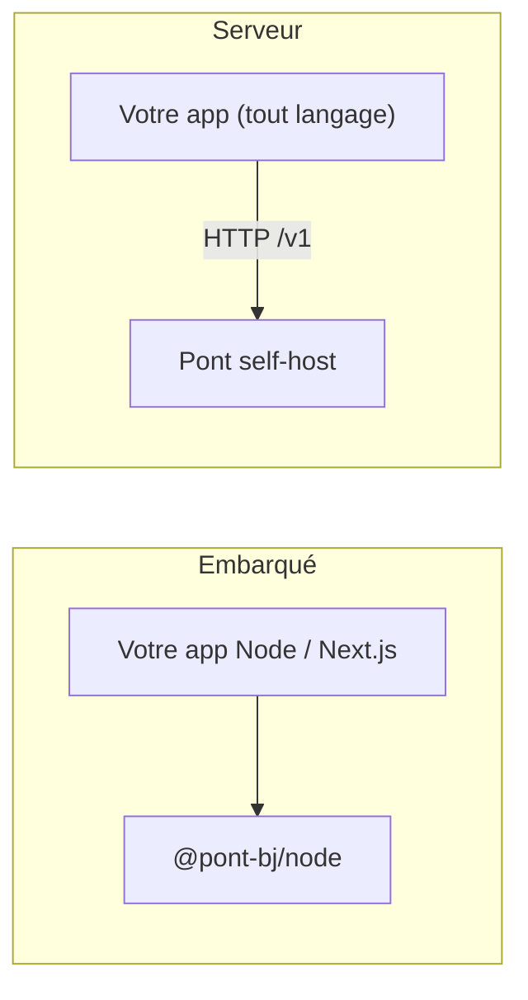

Vous n'avez pas besoin de cloner Pont ni de lancer Docker pour l'utiliser. Chaque brique est un paquet npm indépendant : prenez seulement celle dont vous avez besoin.

```bash
npm install @pont-bj/node      # encaisser et décaisser, dans votre processus
npm install @pont-bj/ledger    # un registre en partie double et des portefeuilles
```

## Que voulez-vous faire ?

| Je veux… | Paquet | Page |
|---|---|---|
| Encaisser un paiement mobile money depuis mon app Node ou Next.js | `@pont-bj/node` | [Moteur embarqué](/modules/moteur-embarque) |
| Tenir des soldes, des dépôts, des transferts, des plafonds | `@pont-bj/ledger` | [Registre et portefeuilles](/modules/registre-et-portefeuilles) |
| Recevoir ou envoyer des webhooks signés | `@pont-bj/node`, `@pont-bj/core` | [Webhooks et signatures](/modules/webhooks-et-signatures) |
| Gérer rôles et permissions de mon équipe | `@pont-bj/auth` | [Rôles et authentification](/guides/roles-et-authentification) |
| Tout avoir clé en main (API, dashboard, planificateur) | serveur Docker | [Installation](/demarrer/installation) |

La liste complète est dans [Paquets npm](/reference/paquets).

## Deux façons de l'utiliser



- **Embarqué** : le moteur tourne dans votre processus TypeScript. Zéro service en plus ; vous gérez le stockage.
- **Serveur** : un service Pont (Docker) avec API HTTP, dashboard et planificateur. Utilisable depuis n'importe quel langage ; voir les [tutoriels](/tutoriels/paiement-de-factures).

<Callout type="info">
Tous les extraits de cette section ont été exécutés sur la version du dépôt (modèle en mémoire, sandbox). Aucun vrai agrégateur n'a été contacté.
</Callout>
