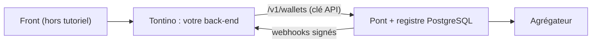

Ce tutoriel construit le **back-end** d'une application imaginaire, **Tontino** : chaque utilisateur a un portefeuille, l'alimente par mobile money, envoie de l'argent à un autre utilisateur et retire vers son téléphone. Le front-end est laissé de côté.

Le code est en **TypeScript** mais ne fait que de l'HTTP et du JSON : il se traduit tel quel dans un autre langage.

<Callout type="warn">
Le portefeuille est une recette en **aperçu**. Il exige `PONT_STORE=postgres` (avec Convex, `/v1/wallets` répond `501 ledger_unavailable`). Les plafonds par défaut sont des exemples, pas des valeurs réglementaires : un portefeuille qui détient de l'argent d'autrui relève de la réglementation applicable (agrément, BCEAO) et doit être validé par un juriste. Tout se teste ici dans le sandbox, sans agrégateur réel.
</Callout>

## Le principe : Pont tient les comptes, votre back-end tient les utilisateurs



- **Vous** : comptes, authentification, qui est qui. Un utilisateur Pont est simplement une chaîne (`^[A-Za-z0-9_-]{1,64}$`) : l'identifiant de votre base.
- **Pont** : soldes, registre en partie double, plafonds, frais, workflow de retrait, gel. Voir [Portefeuille et registre](/guides/portefeuille-et-registre).

Règle d'or : **ne tenez jamais de solde dans votre propre base.** La seule source de vérité est le registre de Pont ; votre back-end le lit.

## Prérequis

- Node.js 20+, Docker, Git.
- Pont installé en **PostgreSQL** ([Installation](/demarrer/installation)) : dans le `.env` de Pont, `PONT_STORE=postgres`.

## Modules utilisés

| Module | Rôle |
|---|---|
| `express` (v5) | Serveur HTTP |
| `zod` | Validation des entrées et des réponses de Pont |
| `tsx`, `vitest` | Exécution et tests |

Pas de SDK obligatoire : l'API REST de Pont est le contrat. Détail des paquets : [Paquets npm](/reference/paquets).

<Steps>
<Step>

## 1. Configurer Pont pour le portefeuille

Dans le `.env` de Pont (voir [Variables d'environnement](/reference/variables-environnement)) :

```bash
PONT_STORE=postgres
PONT_WALLET_CURRENCY=XOF
PONT_WITHDRAWAL_FEE_BPS=100   # 1 % de frais de retrait
PONT_LIMITS='{"tiers":{"decouverte":{"maxBalance":100000,"maxSingle":25000,"maxDailyOut":50000,"maxMonthlyOut":200000}}}'
```

Relancez Pont (`./setup.sh` ou `docker compose up -d`), puis vérifiez :

```bash
npx @pont-bj/cli doctor
```

Les paliers par défaut sont `basique` et `complet` ; `PONT_LIMITS` en ajoute ou les redéfinit.

</Step>
<Step>

## 2. Initialiser le projet

```bash
mkdir tontino && cd tontino
npm init -y
npm install express@5 zod
npm install -D typescript tsx vitest @types/express @types/node
npx tsc --init --strict --target es2022 --module nodenext --moduleResolution nodenext --outDir dist --rootDir src
mkdir src
```

`package.json` : ajoutez `"type": "module"` et les scripts `dev` (`tsx watch --env-file=.env src/index.ts`), `build` (`tsc`), `start` (`node --env-file=.env dist/index.js`), `test` (`vitest run`).

`.env` (à mettre dans `.gitignore`) :

```bash
PONT_URL="http://localhost:8787"
PONT_API_KEY="<PONT_API_KEY du .env de Pont>"
PONT_WEBHOOK_SECRET="<rempli à l'étape 8>"
PORT=4100
```

`src/env.ts` :

```ts
import { z } from "zod";

export const env = z
  .object({
    PONT_URL: z.string().url(),
    PONT_API_KEY: z.string().min(1),
    PONT_WEBHOOK_SECRET: z.string().min(1),
    PORT: z.coerce.number().int().default(4100),
  })
  .parse(process.env);
```

</Step>
<Step>

## 3. Le client Pont typé

Les montants sont des **entiers** (XOF). Les erreurs métier de Pont arrivent en `422` avec un `code` : `limit_exceeded` (avec `limit` : `frozen`, `max_single`, `max_balance`, `max_daily_out`, `max_monthly_out`, `unknown_tier`), `insufficient_funds`, `withdrawal_failed`. `src/pont.ts` :

```ts
import { z } from "zod";
import { env } from "./env.js";

export class PontError extends Error {
  constructor(
    readonly status: number,
    readonly code: string,
    readonly limit: string | undefined,
    message: string,
  ) {
    super(message);
  }
}

const errorBody = z.object({
  error: z.object({ code: z.string(), message: z.string(), limit: z.string().optional() }),
});

export async function pont<T>(
  method: "GET" | "POST" | "PUT",
  path: string,
  schema: z.ZodType<T>,
  body?: unknown,
  idempotencyKey?: string,
): Promise<T> {
  const res = await fetch(`${env.PONT_URL}${path}`, {
    method,
    headers: {
      authorization: `Bearer ${env.PONT_API_KEY}`,
      "content-type": "application/json",
      ...(idempotencyKey ? { "idempotency-key": idempotencyKey } : {}),
    },
    body: body === undefined ? undefined : JSON.stringify(body),
  });
  const json: unknown = await res.json();
  if (!res.ok) {
    const e = errorBody.safeParse(json);
    throw new PontError(
      res.status,
      e.success ? e.data.error.code : "unknown",
      e.success ? e.data.error.limit : undefined,
      e.success ? e.data.error.message : "Erreur Pont",
    );
  }
  return schema.parse(json);
}

export const walletSchema = z.object({
  userId: z.string(),
  currency: z.string(),
  available: z.number().int(),
  held: z.number().int(),
  tier: z.string().nullable(),
  frozen: z.boolean(),
});

export const paymentSchema = z
  .object({ id: z.string(), status: z.string(), nextAction: z.unknown().optional() })
  .passthrough();
```

</Step>
<Step>

## 4. Ouvrir un portefeuille et lire le solde

À l'inscription d'un utilisateur de Tontino, attribuez-lui un palier. `PUT /v1/wallets/{user}` crée le portefeuille s'il n'existe pas. `src/portefeuille.ts` :

```ts
import { Router } from "express";
import { z } from "zod";
import { PontError, paymentSchema, pont, walletSchema } from "./pont.js";

export const portefeuille = Router();

// En vrai : l'identifiant vient de VOTRE authentification, jamais du corps de la requête.
const utilisateur = (req: { header(n: string): string | undefined }) =>
  z.string().regex(/^[A-Za-z0-9_-]{1,64}$/).parse(req.header("x-user-id"));

// Traduit les erreurs métier de Pont en réponses claires pour le front.
function erreur(e: unknown, res: import("express").Response) {
  if (e instanceof PontError && e.status === 422) {
    return res.status(422).json({ code: e.code, plafond: e.limit, message: e.message });
  }
  if (e instanceof PontError) return res.status(502).json({ code: e.code, message: e.message });
  throw e;
}

portefeuille.put("/moi/portefeuille", async (req, res) => {
  const user = utilisateur(req);
  const wallet = await pont("PUT", `/v1/wallets/${user}`, walletSchema, { tier: "decouverte" });
  res.json(wallet);
});

portefeuille.get("/moi/portefeuille", async (req, res) => {
  try {
    res.json(await pont("GET", `/v1/wallets/${utilisateur(req)}`, walletSchema));
  } catch (e) {
    erreur(e, res);
  }
});

const movements = z.object({
  data: z.array(
    z.object({
      entryId: z.string(),
      accountId: z.string(),
      direction: z.enum(["debit", "credit"]),
      amount: z.number().int(),
      createdAt: z.number(),
    }),
  ),
});

portefeuille.get("/moi/mouvements", async (req, res) => {
  res.json(await pont("GET", `/v1/wallets/${utilisateur(req)}/movements`, movements));
});
```

`available` est le solde disponible ; `held` est l'argent bloqué par des retraits en cours.

</Step>
<Step>

## 5. Déposer (alimenter le portefeuille)

Un dépôt est un paiement mobile money encaissé par Pont. Le portefeuille est **crédité à `payment.succeeded`**, après vérification auprès de l'agrégateur, jamais à la création. Ajoutez à `src/portefeuille.ts` :

```ts
const depot = z.object({
  montant: z.number().int().positive(),
  telephone: z.string().regex(/^\+\d{8,15}$/),
  operateur: z.string().optional(), // ex. "mtn_bj"
  reference: z.string().min(1).max(64), // générée par le front, unique par tentative
});

portefeuille.post("/moi/depots", async (req, res) => {
  const d = depot.safeParse(req.body);
  if (!d.success) return res.status(400).json({ erreur: d.error.flatten() });
  try {
    const paiement = await pont("POST", `/v1/wallets/${utilisateur(req)}/deposits`, paymentSchema, {
      amount: d.data.montant,
      country: "BJ",
      phone: d.data.telephone,
      ...(d.data.operateur ? { operator: d.data.operateur } : {}),
      reference: d.data.reference,
    });
    // Le front suit nextAction (redirection, validation sur le téléphone…).
    res.status(201).json({ paiementId: paiement.id, nextAction: paiement.nextAction ?? null });
  } catch (e) {
    erreur(e, res);
  }
});
```

Rappeler la route avec la même `reference` ne crédite jamais deux fois. Pont rattrape aussi, toutes les 30 s, les paiements réussis des dernières 24 h si un webhook interne a été manqué.

</Step>
<Step>

## 6. Retirer vers un téléphone

Le retrait est un workflow : vérifier les plafonds → bloquer les fonds (`available` → `held`) → envoyer le décaissement → solder, ou **annuler et libérer** les fonds en cas d'échec. Le `montant` est ce que reçoit le bénéficiaire ; les frais (`PONT_WITHDRAWAL_FEE_BPS`) s'ajoutent au débit.

```ts
const retrait = z.object({
  montant: z.number().int().positive(),
  telephone: z.string().regex(/^\+\d{8,15}$/),
  operateur: z.string(), // obligatoire, ex. "mtn_bj"
  reference: z.string().min(1).max(64),
});

const resultatRetrait = z.object({
  id: z.string(),
  status: z.literal("succeeded"),
  payoutId: z.string().nullable(),
  amount: z.number().int(),
  fee: z.number().int(),
});

portefeuille.post("/moi/retraits", async (req, res) => {
  const r = retrait.safeParse(req.body);
  if (!r.success) return res.status(400).json({ erreur: r.error.flatten() });
  try {
    const out = await pont(
      "POST",
      `/v1/wallets/${utilisateur(req)}/withdrawals`,
      resultatRetrait,
      { amount: r.data.montant, country: "BJ", phone: r.data.telephone, operator: r.data.operateur, reference: r.data.reference },
    );
    res.status(201).json(out);
  } catch (e) {
    erreur(e, res); // limit_exceeded, insufficient_funds, withdrawal_failed
  }
});
```

Un retrait refusé par l'agrégateur ne perd jamais l'argent : les fonds bloqués sont libérés (`withdrawal_failed`).

</Step>
<Step>

## 7. Transférer entre utilisateurs

Un transfert est interne : une écriture au registre, instantanée, sans agrégateur. `fee` (optionnel) est à la charge de l'expéditeur ; Pont ne le calcule pas, c'est à vous de le fixer.

```ts
const transfert = z.object({
  vers: z.string().regex(/^[A-Za-z0-9_-]{1,64}$/),
  montant: z.number().int().positive(),
  reference: z.string().min(1).max(64),
});

portefeuille.post("/moi/transferts", async (req, res) => {
  const t = transfert.safeParse(req.body);
  if (!t.success) return res.status(400).json({ erreur: t.error.flatten() });
  try {
    const out = await pont(
      "POST",
      "/v1/wallets/transfers",
      z.object({ from: walletSchema, to: walletSchema }),
      { from: utilisateur(req), to: t.data.vers, amount: t.data.montant, reference: t.data.reference },
    );
    res.status(201).json({ solde: out.from.available });
  } catch (e) {
    erreur(e, res);
  }
});
```

Le destinataire doit exister : créez son portefeuille à son inscription (étape 4).

</Step>
<Step>

## 8. Recevoir les webhooks

Pour afficher une notification (« Dépôt reçu »), écoutez les événements de Pont. L'en-tête `Pont-Signature: t=<unix>,v1=<hmac>` signe `t + "." + corps brut` avec votre secret.

```ts
import express, { Router } from "express";
import { createHmac, timingSafeEqual } from "node:crypto";
import { env } from "./env.js";

export const webhooks = Router();
const vus = new Set<string>(); // en production : table avec clé primaire (voir tutoriel factures)

function signatureValide(entete: string | undefined, brut: Buffer): boolean {
  if (!entete) return false;
  const parties = entete.split(",");
  const t = parties.find((p) => p.startsWith("t="))?.slice(2);
  if (!t || Math.abs(Date.now() / 1000 - Number(t)) > 300) return false;
  const attendu = createHmac("sha256", env.PONT_WEBHOOK_SECRET).update(`${t}.${brut.toString("utf8")}`).digest();
  return parties
    .filter((p) => p.startsWith("v1="))
    .some((p) => {
      const recu = Buffer.from(p.slice(3), "hex");
      return recu.length === attendu.length && timingSafeEqual(recu, attendu);
    });
}

webhooks.post("/webhooks/pont", express.raw({ type: "*/*" }), (req, res) => {
  const brut = req.body as Buffer;
  if (!signatureValide(req.header("pont-signature"), brut)) return res.sendStatus(401);
  const id = req.header("pont-event-id");
  if (id && vus.has(id)) return res.sendStatus(200);
  if (id) vus.add(id);
  const evenement: unknown = JSON.parse(brut.toString("utf8"));
  // Notifiez l'utilisateur ici selon evenement.type (payment.succeeded, payout.succeeded…).
  console.log("événement Pont", (evenement as { type?: string }).type);
  res.sendStatus(200);
});
```

Déclarez l'URL auprès de Pont (le secret n'est affiché **qu'une fois**) :

```bash
PONT_ADMIN_TOKEN=$(grep '^PONT_ADMIN_TOKEN=' ../pont/.env | cut -d= -f2 | tr -d '"')
curl -s -X POST http://localhost:8787/admin/webhooks/endpoints \
  -H "authorization: Bearer $PONT_ADMIN_TOKEN" -H "content-type: application/json" \
  -d '{"url":"http://host.docker.internal:4100/webhooks/pont"}'
```

Copiez le `secret` (`whsec_…`) dans `PONT_WEBHOOK_SECRET`.

Et `src/index.ts` (le webhook **avant** `express.json()`) :

```ts
import express from "express";
import { env } from "./env.js";
import { portefeuille } from "./portefeuille.js";
import { webhooks } from "./webhooks.js";

const app = express();
app.use(webhooks);
app.use(express.json());
app.use(portefeuille);
app.listen(env.PORT, () => console.log(`Tontino sur :${env.PORT}`));
```

</Step>
<Step>

## 9. Geler un compte

Pour une fraude ou une demande de l'autorité, le gel interdit toute sortie (retraits et transferts) ; les dépôts continuent d'être reçus. C'est une action d'**administration**, avec le jeton admin, à réserver à vos opérateurs :

```bash
curl -s -X POST http://localhost:8787/admin/wallets/awa/freeze \
  -H "authorization: Bearer $PONT_ADMIN_TOKEN" -H "content-type: application/json" \
  -d '{"frozen":true}'
```

Une opération sur un compte gelé répond `422 limit_exceeded` avec `limit: "frozen"`. Ne mettez jamais le jeton admin dans le code que vous exposez à vos utilisateurs.

</Step>
<Step>

## 10. Tester avec les numéros magiques

Dans le sandbox, le numéro choisit le scénario (`+229010` + `0000001`…`0000008`).

```bash
npm run dev
H='-H content-type:application/json -H x-user-id:awa'
curl -s -X PUT localhost:4100/moi/portefeuille $H
curl -s -X POST localhost:4100/moi/depots $H -d '{"montant":20000,"telephone":"+2290100000001","reference":"dep-1"}'
sleep 5; curl -s localhost:4100/moi/portefeuille $H        # available: 20000
curl -s -X POST localhost:4100/moi/retraits $H -d '{"montant":5000,"telephone":"+2290100000001","operateur":"mtn_bj","reference":"ret-1"}'
curl -s localhost:4100/moi/mouvements $H
```

Scénarios utiles : `...0001` succès, `...0002` solde insuffisant, `...0004` webhook en double (le solde ne doit être crédité qu'une fois), `...0006` agrégateur en panne avant envoi (le retrait échoue et les fonds sont libérés), `...0007` délai ambigu (réconcilié par Pont, jamais renvoyé chez un autre agrégateur).

Testez aussi les plafonds : avec le palier `decouverte` ci-dessus, un retrait de 30 000 doit répondre `limit_exceeded` / `max_single`.

</Step>
<Step>

## 11. Déployer

1. **Pont** en production : [Mise en production](/guides/mise-en-production). Gardez `/admin` privé, sauvegardez la base PostgreSQL (le registre en est le cœur) et testez la restauration.
2. **Tontino** : image Node.

```dockerfile
FROM node:22-alpine
WORKDIR /app
COPY package*.json ./
RUN npm ci
COPY . .
RUN npm run build
CMD ["node", "dist/index.js"]
```

3. **Variables** : `PONT_URL` (adresse privée), `PONT_API_KEY`, `PONT_WEBHOOK_SECRET` via le gestionnaire de secrets de l'hébergeur.
4. **Webhook** : redéclarez l'URL publique HTTPS auprès du Pont de production (nouveau secret).
5. **Passage en réel** : [Passer en réel](/demarrer/passer-en-reel), avec vos clés d'agrégateur dans Pont. Votre code ne change pas.

</Step>
</Steps>

## Check-list avant le live

- Aucun solde dans votre base : le registre de Pont est la seule source.
- L'identifiant utilisateur vient de **votre** authentification, jamais du corps de la requête.
- Les références sont uniques par opération (dépôt, retrait, transfert) : elles garantissent l'idempotence.
- Signature des webhooks vérifiée sur le corps brut, dédoublonnage sur `Pont-Event-Id`.
- Plafonds et frais validés avec votre conseil juridique ; `/admin` jamais public.
- Sauvegarde PostgreSQL testée.

## Pour aller plus loin

- [Portefeuille et registre](/guides/portefeuille-et-registre)
- [Rôles et authentification](/guides/roles-et-authentification)
- [Tutoriel : paiement de factures](/tutoriels/paiement-de-factures)
