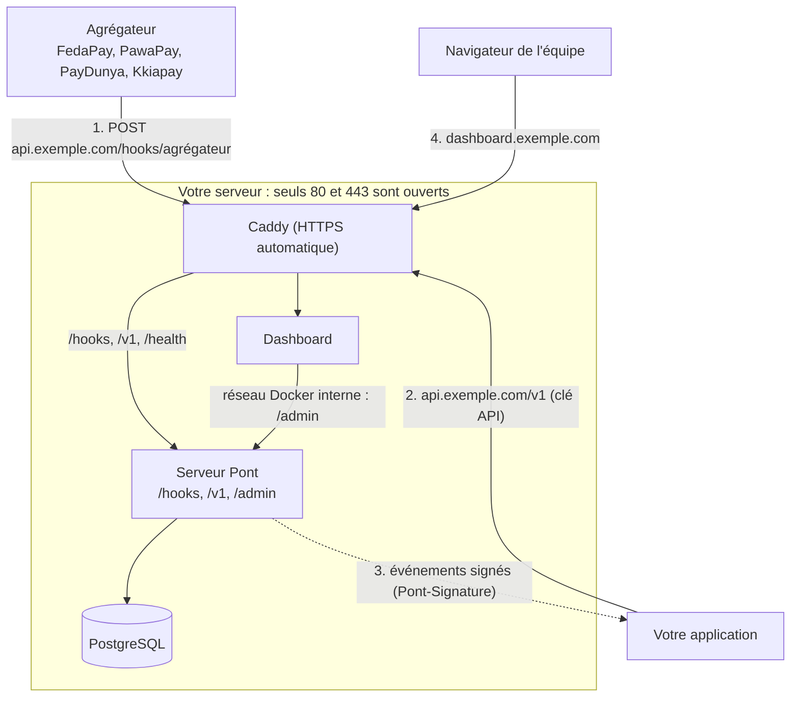

# Mise en production

Ce guide mène une installation self-host de `localhost` à un serveur public prêt pour de vrais paiements. Il suppose que `./setup.sh` fonctionne déjà en local ([démarrer](README.md)).

## Ce qui doit être public, et ce qui ne doit jamais l'être

Trois flux d'URL, trois publics différents :



| Flux | URL | Qui appelle qui |
|---|---|---|
| Agrégateur vers Pont | `https://api.votre-domaine/hooks/<agrégateur>` | FedaPay, PawaPay, PayDunya, Kkiapay appellent votre serveur |
| Votre application vers Pont | `https://api.votre-domaine/v1/...` avec la clé API | Votre application appelle votre serveur |
| Pont vers votre application | L'adresse ajoutée dans la page Webhooks du dashboard | Pont appelle votre application : elle doit être joignable depuis le serveur |
| Navigateur vers le dashboard | `https://dashboard.votre-domaine` | L'équipe |

**Il n'y a pas de « port à ouvrir » propre aux webhooks.** Le seul point d'entrée public est HTTPS (443, et 80 pour l'obtention des certificats et la redirection). Un agrégateur ne peut pas appeler `localhost` : tant que `PONT_PUBLIC_URL` vaut `http://localhost:8787`, l'URL affichée par le dashboard est inutilisable chez lui.

**Ne jamais exposer sur Internet :**

| Service | Pourquoi | Dans le profil production |
|---|---|---|
| PostgreSQL (5432) | Toute votre base | Aucun port publié |
| Convex (3210, 3211, 6791) | Base et son dashboard d'administration | Publiés sur `127.0.0.1` seulement |
| Mailpit (1025, 8025) | Boîte mail de test sans authentification | Publié sur `127.0.0.1`, et hors production (profil `mail`) |
| `/admin` du serveur Pont | API du dashboard : pilote clés, retraits, webhooks | Refusé (403) par le proxy ; le dashboard l'appelle par le réseau Docker |
| Ports 8787 et 3300 | Accès direct qui contournerait le proxy | Liés à `127.0.0.1` |

## Prérequis

1. **Un serveur** (VPS Linux) avec Docker et Docker Compose, et `openssl`. Quelques Go de disque pour la base.
2. **Deux noms de domaine** (ou sous-domaines) distincts, par exemple `api.votre-fintech.com` et `dashboard.votre-fintech.com`.
3. **DNS** : un enregistrement `A` (et `AAAA` si votre serveur a une IPv6) pour chacun, vers l'adresse du serveur. Attendez la propagation avant de lancer l'installation : Let's Encrypt doit pouvoir joindre le serveur pour émettre les certificats.
4. **Pare-feu** : n'ouvrir que 22 (SSH), 80 et 443 (TCP, et 443 UDP pour HTTP/3). Par exemple avec `ufw` :

```bash
sudo ufw default deny incoming
sudo ufw allow 22/tcp
sudo ufw allow 80/tcp
sudo ufw allow 443
sudo ufw enable
```

> **Attention :** Docker publie les ports en contournant `ufw`. C'est pourquoi le profil production lie lui-même les services internes à `127.0.0.1` au lieu de compter sur le pare-feu. Vérifiez l'exposition réelle (voir la check-list).

## Installer en production

```bash
cd deploy/self-host
./setup.sh --prod
```

Le script :
- lit `PONT_DOMAIN` et `DASHBOARD_DOMAIN` (variables d'environnement, ou `.env`, ou il les demande) ;
- renseigne `PONT_PUBLIC_URL`, `DASHBOARD_URL` et ajoute le dashboard à `PONT_TRUSTED_ORIGINS` ;
- lie le serveur Pont et le dashboard à `127.0.0.1` et démarre Caddy (profil `prod`), seul service public ;
- **ne passe en `live` que si vous tapez `LIVE`** à la question (ou `PONT_CONFIRM_LIVE=LIVE` en non interactif), et refuse `live` avec `PONT_SANDBOX=true` ;
- ne supprime jamais de volume : relancez-le sans crainte pour une mise à jour.

Non interactif :

```bash
PONT_DOMAIN=api.votre-fintech.com DASHBOARD_DOMAIN=dashboard.votre-fintech.com ./setup.sh --prod
```

Pour revenir au développement : `./setup.sh --dev` (les ports se rouvrent sur la machine, Caddy s'arrête).

### Le proxy Caddy fourni

Le fichier `deploy/self-host/Caddyfile` fait ceci : HTTPS automatique, corps limité (1 Mo pour l'API, 2 Mo pour le dashboard), en-têtes de sécurité, journal sans en-têtes `Authorization` ni cookies, `/hooks`, `/v1` et `/health` vers le serveur, `/admin` refusé, tout le reste en 404.

```caddyfile title="deploy/self-host/Caddyfile"
(securite) {
	header {
		Strict-Transport-Security "max-age=31536000"
		X-Content-Type-Options "nosniff"
		Referrer-Policy "no-referrer"
		X-Frame-Options "DENY"
		-Server
	}
}

(journal) {
	log {
		output stdout
		format filter {
			wrap json
			request>headers>Authorization delete
			request>headers>Cookie delete
			request>headers>Idempotency-Key delete
			resp_headers>Set-Cookie delete
		}
	}
}

{$PONT_DOMAIN} {
	import securite
	import journal
	request_body {
		max_size 1MB
	}

	handle /admin* {
		respond "Interdit" 403
	}

	@public path /hooks/* /v1/* /health
	handle @public {
		reverse_proxy pont:8080 {
			header_up -X-Forwarded-For
			header_up X-Forwarded-For {remote_host}
		}
	}

	handle {
		respond "Introuvable" 404
	}
}

{$DASHBOARD_DOMAIN} {
	import securite
	import journal
	request_body {
		max_size 2MB
	}
	reverse_proxy dashboard:3000
}
```

### Variante Nginx

Si vous préférez Nginx (avec `certbot` pour les certificats), arrêtez le service `caddy` (retirez `prod` de `COMPOSE_PROFILES`) et gardez `PONT_BIND=127.0.0.1` et `DASHBOARD_BIND=127.0.0.1` : Nginx, installé sur l'hôte, parle aux ports locaux 8787 et 3300.

```nginx title="/etc/nginx/sites-available/pont"
server {
    listen 80;
    server_name api.votre-fintech.com dashboard.votre-fintech.com;
    return 301 https://$host$request_uri;
}

server {
    listen 443 ssl http2;
    server_name api.votre-fintech.com;
    ssl_certificate     /etc/letsencrypt/live/api.votre-fintech.com/fullchain.pem;
    ssl_certificate_key /etc/letsencrypt/live/api.votre-fintech.com/privkey.pem;

    client_max_body_size 1m;
    add_header Strict-Transport-Security "max-age=31536000" always;
    add_header X-Content-Type-Options "nosniff" always;
    add_header Referrer-Policy "no-referrer" always;
    server_tokens off;

    location ^~ /admin { return 403; }

    location ~ ^/(hooks|v1)/ {
        proxy_pass http://127.0.0.1:8787;
        proxy_set_header Host $host;
        proxy_set_header X-Forwarded-For $remote_addr;
        proxy_set_header X-Forwarded-Proto https;
    }
    location = /health { proxy_pass http://127.0.0.1:8787; }
    location / { return 404; }
}

server {
    listen 443 ssl http2;
    server_name dashboard.votre-fintech.com;
    ssl_certificate     /etc/letsencrypt/live/dashboard.votre-fintech.com/fullchain.pem;
    ssl_certificate_key /etc/letsencrypt/live/dashboard.votre-fintech.com/privkey.pem;

    client_max_body_size 2m;
    add_header Strict-Transport-Security "max-age=31536000" always;
    add_header X-Content-Type-Options "nosniff" always;
    server_tokens off;

    location / {
        proxy_pass http://127.0.0.1:3300;
        proxy_set_header Host $host;
        proxy_set_header X-Forwarded-For $remote_addr;
        proxy_set_header X-Forwarded-Proto https;
    }
}
```

> **À savoir :** Le sandbox est refusé en `live`, et le mode `live` impose un stockage durable (PostgreSQL ou Convex) : un serveur en mémoire ne démarre pas.

## Déclarer les webhooks chez les agrégateurs

Dans le dashboard, la page Développeurs puis Webhooks affiche l'URL exacte de chaque agrégateur (`https://api.votre-domaine/hooks/<agrégateur>`). Les clés se saisissent dans la page Clés ([coffre et clés](cles-et-webhooks.md)). Ce que fait chaque adaptateur de Pont, relevé dans le code :

| Agrégateur | À déclarer chez l'agrégateur | Ce que Pont vérifie | Champs à saisir dans Pont |
|---|---|---|---|
| FedaPay | Un endpoint webhook vers `/hooks/fedapay` (le secret est propre à chaque endpoint, différent en test et en live). La liste d'adresses IP de FedaPay est publiée si vous voulez filtrer. | En-tête `X-FEDAPAY-SIGNATURE` (HMAC horodaté, tolérance de 5 minutes) | Clé secrète, secret de webhook |
| PawaPay | Les URL de callback vers `/hooks/pawapay` dans le tableau de bord PawaPay (l'adaptateur Pont n'envoie pas l'URL dans ses requêtes). | Avec les clés publiques de callback : signature RFC 9421 exigée. Sans elles : seul `Content-Digest` est contrôlé si présent. Le statut est toujours relu par l'API. | Jeton d'API, clés publiques de callback (JSON, recommandé en production) |
| PayDunya | Rien dans le tableau de bord pour les paiements : Pont envoie l'URL de rappel `/hooks/paydunya` avec chaque facture et chaque retrait. | Hash SHA-512 de la clé maître. Ce hash est identique pour tous les IPN : Pont relit toujours le statut par l'API. | Clé maître, clé privée, jeton, nom de la boutique |
| Kkiapay | Un endpoint webhook vers `/hooks/kkiapay` dans le tableau de bord Kkiapay, avec le secret choisi. | En-tête `x-kkiapay-secret` égal au secret saisi (contrôle d'origine), puis statut relu par l'API | Clé publique, clé privée, clé secrète, secret de webhook |

> **Attention :** Les rubriques exactes des tableaux de bord changent. Pour les libellés précis, suivez la documentation de chaque agrégateur. Kkiapay ne peut pas être combiné avec un autre agrégateur (CGU, article 18) : Pont refuse cette combinaison.

Un paiement ne passe à `succeeded` qu'après vérification par l'API de l'agrégateur : un webhook falsifié ne peut donc pas créditer un compte. Répondez toujours vite : FedaPay désactive un endpoint après plusieurs échecs, et Pont répond 200 aux doublons pour que l'agrégateur ne réessaie pas inutilement.

## Recevoir les événements dans votre application

1. Dans la page Webhooks, ajoutez l'adresse de votre application. Le secret `whsec_…` est affiché une seule fois : copiez-le.
2. Côté application, vérifiez la signature sur le **corps brut** (avant tout `JSON.parse`) :

```ts title="app/api/pont/route.ts"
import { verifyPontSignature } from "@pont/node";

export async function POST(request: Request) {
  const rawBody = await request.text();
  const valid = verifyPontSignature(process.env.PONT_WEBHOOK_SECRET!, rawBody, request.headers.get("pont-signature"));
  if (!valid) return new Response("signature invalide", { status: 401 });

  const event = JSON.parse(rawBody);
  // Traitez l'événement de façon idempotente : le même événement peut arriver plusieurs fois.
  return new Response("ok");
}
```

3. Répondez `2xx` rapidement. Pont réessaie pendant environ 3 jours (livraison au moins une fois) ; l'en-tête `Pont-Event-Id` identifie l'événement. Le bouton « Renvoyer » du dashboard rejoue une livraison.

L'adresse de votre application doit être joignable depuis le serveur Pont. En `live`, les adresses internes (`localhost`, réseaux privés) sont refusées.

## Tester en local avec un tunnel

Pour recevoir de vrais webhooks de test d'un agrégateur sur votre machine, exposez le serveur par un tunnel HTTPS et donnez son adresse à Pont :

```bash
# Cloudflare Tunnel (exemple rapide, sans compte)
cloudflared tunnel --url http://localhost:8787
# ou ngrok
ngrok http 8787
```

Puis, dans `deploy/self-host/.env` : `PONT_PUBLIC_URL=https://<adresse-du-tunnel>` et `docker compose up -d pont`. L'URL à déclarer chez l'agrégateur devient `https://<adresse-du-tunnel>/hooks/<agrégateur>`.

> **Attention :** Un tunnel vers `localhost:8787` expose aussi `/admin` à ceux qui connaissent l'adresse (protégé par le jeton admin seulement). N'utilisez un tunnel que pour des clés de test, et coupez-le après usage. En sandbox (`PONT_SANDBOX=true`), aucun agrégateur n'appelle votre serveur : le tunnel est inutile.

## Sauvegardes

Trois choses à sauvegarder, **hors du serveur** :

1. **La base PostgreSQL** (paiements, registre, clés chiffrées, livraisons) :

```bash
docker compose exec -T postgres pg_dump -U pont pont | gzip > pont-$(date +%F).sql.gz
```

2. **Les comptes du dashboard** (volume `dashboard-data`, un fichier SQLite) :

```bash
docker run --rm -v pont_dashboard-data:/data -v "$PWD":/backup alpine tar czf /backup/dashboard-data-$(date +%F).tgz -C /data .
```

3. **Le fichier `.env`**, et surtout `PONT_ENCRYPTION_KEY`. **Sans elle, les clés d'agrégateurs enregistrées dans le coffre sont irrécupérables** : la base seule ne suffit pas. Conservez `.env` chiffré (gestionnaire de mots de passe, `gpg`) séparément de la base : qui a les deux a vos clés.

Testez une restauration avant d'en avoir besoin. Avec une base à vous (`DATABASE_URL`), appliquez plutôt les sauvegardes de votre hébergeur.

## Mettre à jour

```bash
git pull
cd deploy/self-host
./setup.sh --prod
```

Le script est relançable : il garde vos secrets et vos volumes, reconstruit les images et applique les changements de tables. Il n'y a pas encore de migrations versionnées : faites une sauvegarde avant chaque mise à jour.

## Check-list avant le live

- [ ] Les deux domaines pointent vers le serveur et les certificats sont émis (`https://api.votre-domaine/health` répond `200`).
- [ ] Depuis une autre machine, seuls 80 et 443 répondent. Les ports 5432, 3210, 3300, 8787 et 8025 sont fermés.
- [ ] `https://api.votre-domaine/admin/overview` répond `403`.
- [ ] `.env` et `PONT_ENCRYPTION_KEY` sont sauvegardés hors du serveur, et une restauration de la base a été testée.
- [ ] Les clés de **production** de l'agrégateur sont saisies dans la page Clés, et son webhook de production pointe vers l'URL du dashboard.
- [ ] Un paiement réel de faible montant va jusqu'à `succeeded` et le webhook sortant arrive dans votre application (signature vérifiée).
- [ ] SMTP configuré et alertes activées ([e-mail et alertes](email-et-alertes.md)).
- [ ] Le compte administrateur a un mot de passe fort, et l'inscription publique est fermée (`PONT_SIGNUP_ROLE` vide).
- [ ] `PONT_MODE=live` et `PONT_SANDBOX=false`.
